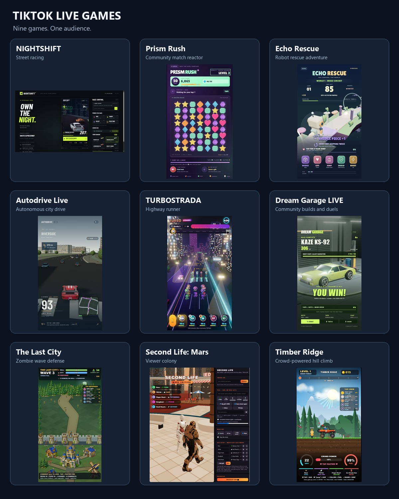
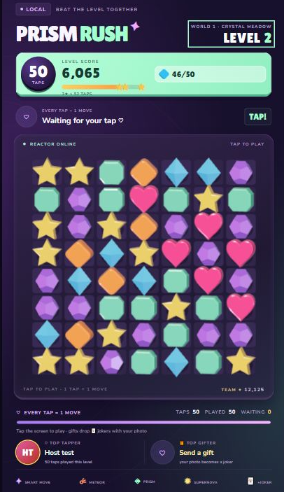
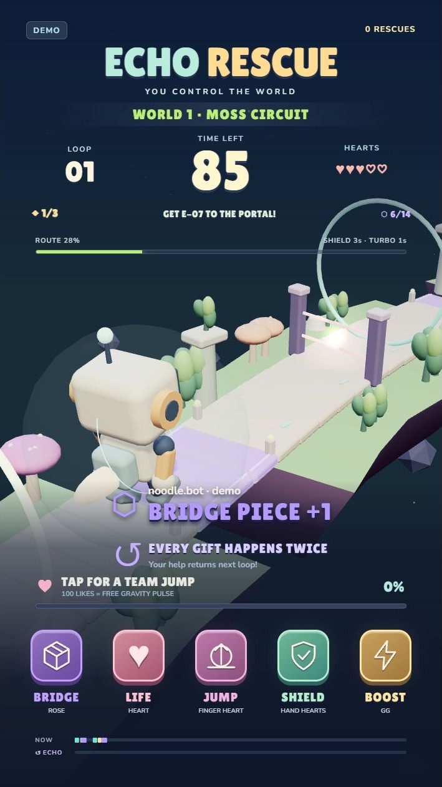
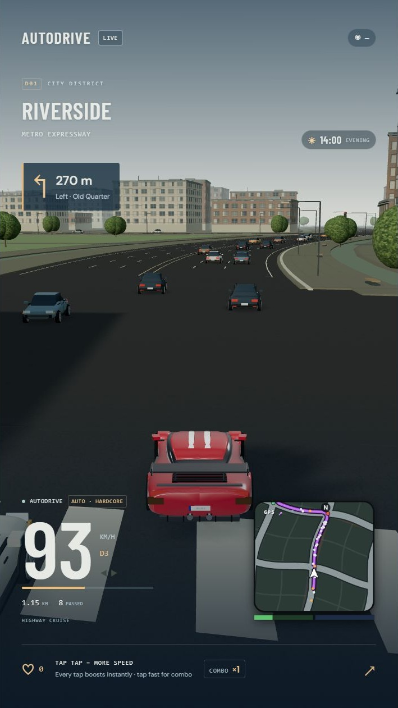
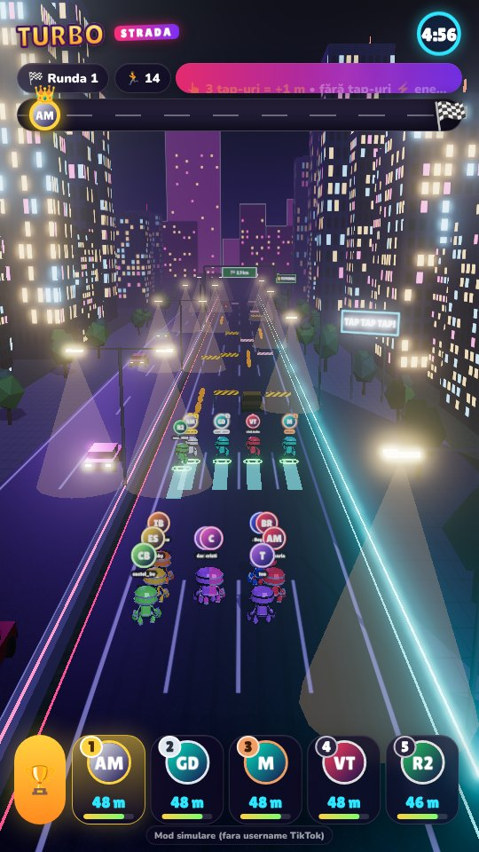
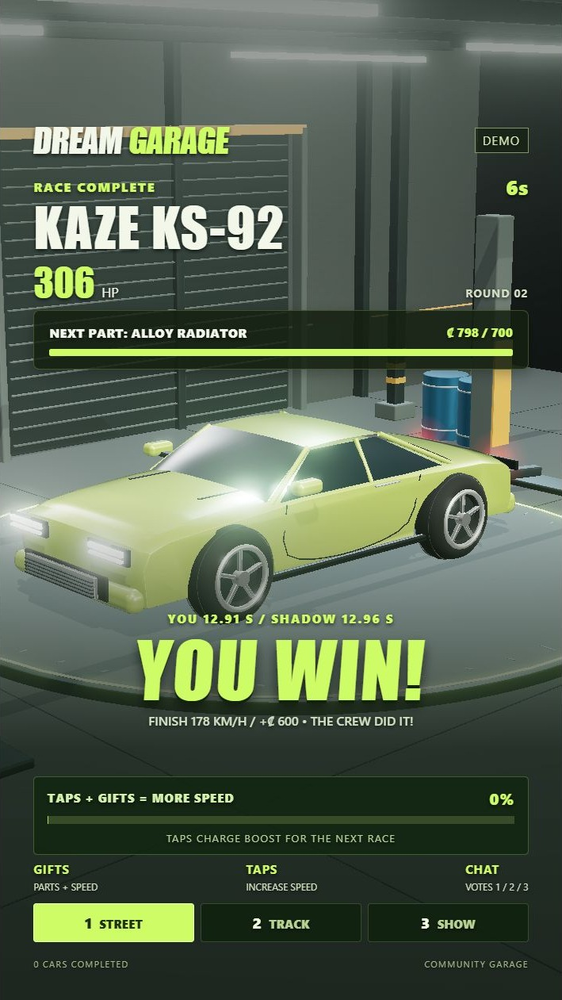
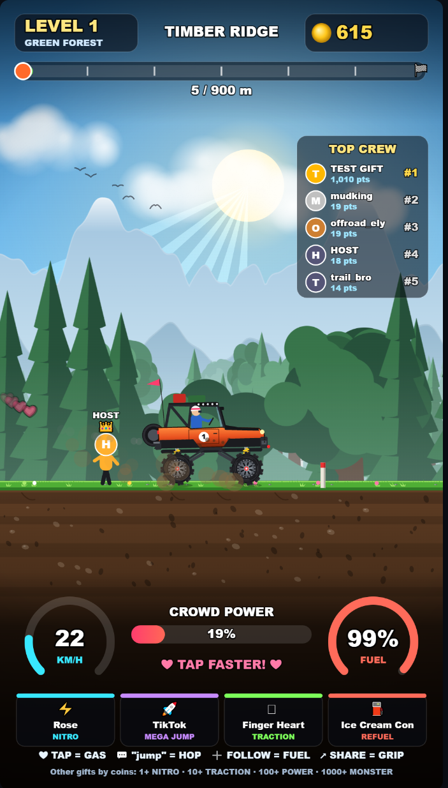

# TikTok LIVE Games

**One audience. Nine ways to play.**

A collection of browser games for portrait TikTok LIVE streams: crowd-powered street racing, a match reactor, an autonomous city drive, a robot adventure, a highway runner, a community-built garage, a zombie-wave city defense, a living Mars colony, and a forest Jeep hill climb.

Built with **JavaScript, Canvas 2D, Three.js, and Node.js**. Run each game locally, try its demo or host controls, and capture the portrait view in OBS or TikTok LIVE Studio.

## Screenshots

Real gameplay and host-interface captures from all nine games. Each game's guide below includes its own preview.



<details>
<summary>View individual game screenshots</summary>

<table>
  <tr>
    <th><a href="nightshift-racing/README.md">NIGHTSHIFT</a> — Street racing</th>
    <th><a href="prism-rush/README.md">Prism Rush</a> — Community match reactor</th>
  </tr>
  <tr>
    <td align="center"><a href="docs/screenshots/nightshift-racing.jpg"></a></td>
    <td align="center"><a href="docs/screenshots/prism-rush-gameplay.png"></a></td>
  </tr>
  <tr>
    <th><a href="echo-rescue/README.md">Echo Rescue</a> — Robot rescue adventure</th>
    <th><a href="nightdrive-live/README.md">Autodrive Live</a> — Autonomous city drive</th>
  </tr>
  <tr>
    <td align="center"><a href="docs/screenshots/echo-rescue.jpg"></a></td>
    <td align="center"><a href="docs/screenshots/autodrive-live.jpg"></a></td>
  </tr>
  <tr>
    <th><a href="turbo-autostrada/CITESTE.md">TURBOSTRADA</a> — Highway runner</th>
    <th><a href="turbo-autostrada/DREAM-GARAGE.md">Dream Garage LIVE</a> — Community builds and duels</th>
  </tr>
  <tr>
    <td align="center"><a href="docs/screenshots/turbostrada.jpg"></a></td>
    <td align="center"><a href="docs/screenshots/dream-garage-live.jpg"></a></td>
  </tr>
  <tr>
    <th><a href="the-last-city/README.md">The Last City</a> — Zombie wave defense</th>
    <th><a href="mars-second-life/README.md">Second Life: Mars</a> — Viewer colony</th>
  </tr>
  <tr>
    <td align="center"><a href="docs/screenshots/the-last-city.png"></a></td>
    <td align="center"><a href="docs/screenshots/second-life-mars.png"></a></td>
  </tr>
  <tr>
    <th colspan="2"><a href="timber-ridge-3d/README.md">Timber Ridge</a> — Crowd-powered hill climb</th>
  </tr>
  <tr>
    <td colspan="2" align="center"><a href="docs/screenshots/timber-ridge.png"></a></td>
  </tr>
</table>

</details>

## Choose a game

| Game | What happens | Start on Windows | Guide |
| --- | --- | --- | --- |
| **NIGHTSHIFT** | One crowd-powered supercar races three automatic rivals. Taps build speed; gifts trigger boosts; points unlock cars. | `nightshift-racing/START-NIGHTSHIFT.bat` | [Racing, garage, and LIVE setup](nightshift-racing/README.md) |
| **Prism Rush** | Every viewer tap plays one gem swap. Gifts trigger powers and avatar jokers; 150 levels reward the top tappers and gifters. | `prism-rush/START.bat` | [Powers, host controls, and relay](prism-rush/README.md) |
| **Echo Rescue** | E-07 explores five floating worlds on autopilot. Gifts build bridges and grant powers; each action returns once as an echo. | `echo-rescue/START.bat` | [Worlds, progression, and viewer actions](echo-rescue/README.md) |
| **Autodrive Live** | An autonomous car explores a fictional city, follows traffic signals, changes lanes, and responds to audience boosts. | `nightdrive-live/START-AUTODRIVE.bat` | [Driving modes and LIVE setup](nightdrive-live/README.md) |
| **TURBOSTRADA** | Viewer avatars run a highway course in Classic, Challenge, Teams, or Elimination mode. | `turbo-autostrada/START.bat` | [Runner setup and modes — Romanian](turbo-autostrada/CITESTE.md) |
| **Dream Garage LIVE** | The audience funds a project car, installs upgrades, and helps it win automatic 400 m duels. | `turbo-autostrada/DREAM-GARAGE.bat` | [LIVE game](turbo-autostrada/DREAM-GARAGE.md) · [Workshop sandbox](turbo-autostrada/DREAM-GARAGE-WORKSHOP.md) |
| **Timber Ridge** | Crowd taps drive a Jeep over hills, rocks, logs and mud. Gifts add power, traction and rescue boosts. | `timber-ridge-3d/START-TIMBER-RIDGE-2D.bat` | [Jeep, gifts, garage and LIVE setup](timber-ridge-3d/README.md) |
| **The Last City** | Every viewer becomes a survivor on the city wall. Taps speed up their shots; gifts repair, build turrets and call meteors against growing zombie waves. | `the-last-city/START-LAST-CITY.bat` | [Waves, survivors, and gifts](the-last-city/README.md) |
| **Second Life — Mars Edition** | A Sims-style Mars colony. Gifts bring viewers in by teleport beam to a park, café, cathedral, studio or skyport; the camera zooms onto their face, with a plumbob and their avatar above their head. | `mars-second-life/START-MARS.bat` | [Places, gifts, and camera](mars-second-life/README.md) |

## Run locally

Use **Node.js 22 or newer** and Edge or Chrome. Enable WebGL2 and hardware acceleration for the 3D games. Windows launchers are included; the Node servers can also be started from a terminal.

Clone the collection:

```powershell
git clone https://github.com/dexterR35/tik-tok-games.git
cd tik-tok-games
```

Choose one game folder, then run its commands:

| Folder | Terminal commands | Local game |
| --- | --- | --- |
| `nightshift-racing` | `npm install`, then `npm start` | `http://127.0.0.1:3316` |
| `prism-rush` | `npm run serve` — bundled assets, no install needed | `http://127.0.0.1:4328` |
| `echo-rescue` | `npm start` — bundled assets, no install needed | `http://127.0.0.1:4317` |
| `nightdrive-live` | `npm install`, then `npm start` | `http://127.0.0.1:4316` |
| `turbo-autostrada` | Copy the configuration below, run `npm install`, then `npm start` | `http://127.0.0.1:3000` |
| `turbo-autostrada` — Dream Garage | `npm install`, then `npm run garage` | `http://127.0.0.1:3210` |
| `timber-ridge-3d` — Timber Ridge 2D | `npm install`, then `npm start` | `http://127.0.0.1:3341` |
| `the-last-city` | `npm install`, then `npm start` | `http://127.0.0.1:3350` |
| `mars-second-life` | `npm install`, then `npm start` | `http://127.0.0.1:3360` |

For example, start NIGHTSHIFT from the repository root:

```powershell
cd nightshift-racing
npm install
npm start
```

NIGHTSHIFT includes its playable `dist` files. Run `npm run build` in that folder to refresh its bundled graphics modules after changing dependencies. Prism Rush also provides `npm run build` for its standalone static demo. These are independent projects, with no root install or root build command.

### TURBOSTRADA configuration

From `turbo-autostrada`, create your private configuration:

```powershell
Copy-Item config.example.json config.json
npm install
npm start
```

Set your TikTok username and panel password in `config.json` before connecting or sharing access. Signing keys, if needed, belong in that private file. Local configurations, saves, and logs are ignored by Git.

For the four separate runner launchers, first copy the per-stream templates:

```powershell
Copy-Item lives/clasic.example.json lives/clasic.json
Copy-Item lives/challenge.example.json lives/challenge.json
Copy-Item lives/echipe.example.json lives/echipe.json
Copy-Item lives/eliminare.example.json lives/eliminare.json
```

Set the intended username in each file, then use `LIVE-1-CLASIC.bat` through `LIVE-4-ELIMINARE.bat`. Their ports are **3001–3004**. See [CITESTE.md](turbo-autostrada/CITESTE.md) for the full setup.

## Capture the game

Use a **1080 × 1920** portrait browser source, or capture the game window. Start the local server first and keep it running throughout the broadcast.

| Game | Clean capture URL |
| --- | --- |
| NIGHTSHIFT | `http://127.0.0.1:3316/?broadcast=1` |
| Prism Rush | `http://127.0.0.1:4328/?capture=1` |
| Echo Rescue | `http://127.0.0.1:4317/?capture=1` |
| Autodrive Live | `http://127.0.0.1:4316/?capture=1` |
| TURBOSTRADA | `http://127.0.0.1:3000/?live=1` — use your stream's port for separate launchers |
| Dream Garage LIVE | `http://127.0.0.1:3210/?source=1` |
| Timber Ridge | `http://127.0.0.1:3341/?broadcast=1` |
| The Last City | `http://127.0.0.1:3350/?broadcast=1` |
| Second Life — Mars Edition | `http://127.0.0.1:3360/?broadcast=1` |

## Connect your audience

**NIGHTSHIFT, Autodrive Live, TURBOSTRADA, Timber Ridge, The Last City, and Second Life — Mars Edition** include local bridges based on the unofficial `tiktok-live-connector`. Use the intended creator account while it is LIVE.

**Echo Rescue, Prism Rush, and Dream Garage LIVE** can receive normalized viewer events through the TURBOSTRADA relay. Start the relay with `node server.js YOUR_TIKTOK_USERNAME` from `turbo-autostrada`, then connect the game through its host panel. Its default WebSocket address is `ws://localhost:3000/ws`.

Demo controls simulate local actions and do not send paid gifts. Static hosted demos do not run a local LIVE bridge. Real TikTok connectivity depends on the connector and service configuration; an on-air test is still required. A connected relay alone does not confirm that an account is LIVE.

## Development

Run checks from the project you are working on:

| Project | Test command |
| --- | --- |
| Echo Rescue | `npm test` |
| Autodrive Live | `npm test` |
| NIGHTSHIFT | `npm test` |
| Prism Rush | `npm test` |
| Dream Garage | `npm run test:garage` in `turbo-autostrada` |
| Timber Ridge | `npm test` |
| The Last City | `npm test` |
| Second Life — Mars Edition | `npm test` |

The repository includes the games, bundled browser assets, original asset sources where available, and screenshots. Installed dependencies, personal settings, saved sessions, deployment archives, and local backups stay on your computer.

Third-party assets retain their own licenses and attributions. See [NIGHTSHIFT model credits](nightshift-racing/dist/assets/model-attributions.json), [Autodrive asset credits](nightdrive-live/public/assets/CREDITS.md), [Echo Rescue vendor notes](echo-rescue/public/vendor/README.txt), and [Dream Garage asset notes](turbo-autostrada/public/garage/assets/ASSET-NOTES.md).
