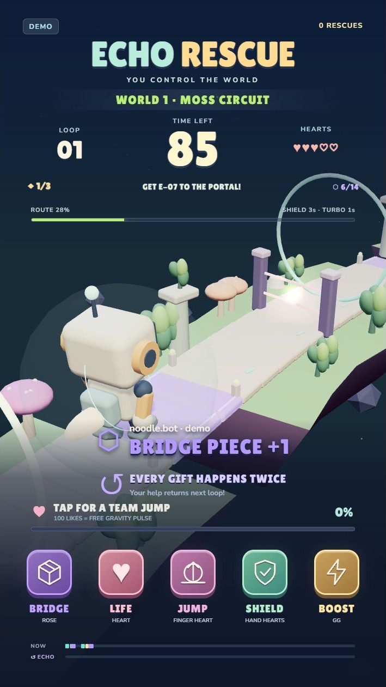

# Echo Rescue — TikTok LIVE game

A portrait 3D game for a TikTok LIVE stream. E-07 moves automatically, viewers send gifts to change the course, and each action returns once as a ghost effect. The game fills the capture frame with its 3D world and game HUD. Host controls run in a separate window.

## Screenshot




## Launch the game

Requires Node.js 22 or newer and Microsoft Edge or Google Chrome with WebGL2/hardware acceleration.

Double-click **START.bat**. It starts the game server and opens a **540 × 960 app-mode game window**, without the browser address bar. On Windows, the launcher uses the existing Edge installation, then Chrome if Edge is unavailable. There is no dependency installation or build step.

- **F:** fullscreen.
- **H:** open host controls in a separate window.
- **Escape:** game menu.
- **Space:** pause or resume the shared game.
- **1–5:** bridge piece, life, jump, shield, boost; local effects are labeled “Host test.”

Capture the game window for the stream. The game preserves a 9:16 aspect ratio when resized. For a local browser capture source, use `http://localhost:4317/?capture=1` at **1080 × 1920**. Capture mode hides the host dock. The regular URL also displays only the game.

The game starts playing immediately with a clearly labeled **DEMO** crew. Demo names are marked as simulated. Connect the TikTok relay to switch demo actions off.

## Host controls

Press H in the game, open **HOST-CONTROLS.bat** after starting the game, or visit `http://localhost:4317/host`.

The host panel can pause/restart the session, choose worlds, show the warp map, toggle automatic progression, test gifts/likes, and connect the TikTok relay. All game windows, host panels and capture sources use **one authoritative server session**. Opening another window does not start another clock or count gifts twice.

The local server listens only on `127.0.0.1`. Stop it with Ctrl+C in the launch console. Settings and expedition records are saved in `data/settings.json` and `data/progress.json`. Restarting resets the current run while preserving earned records and relay preferences.

## View and movement

The camera follows from behind and to the side, looking forward along the course. E-07 faces the direction of travel. Running follows distance traveled, turbo leans the body forward, jumps tuck the legs, and landings compress the chassis. The course uses curved raised terrain, ramps, checkpoint arches and visible crossings. The HUD shows route completion, current checkpoint, built pieces, spare parts and active power duration.

## Viewer actions

| Gift mapping | Effect |
| --- | --- |
| Rose | Add **one bridge piece** to the next incomplete crossing. Pieces stay until the round ends. Combos place distinct pieces; surplus pieces go into storage. |
| Finger Heart | Add 3.2 seconds of gravity jump. Pulses can stack into a longer jump. |
| Heart | Restore **one heart**, up to five. At full health, store a spare heart that automatically prevents a fatal hit. |
| Hand Hearts | Add six seconds of protection from hazards and knockback. Repeated gifts stack duration. |
| GG | Add four seconds of 1.8× speed. Two gifts give eight seconds, rather than refreshing one four-second effect. |
| 100 likes | Charge a free team gravity jump. Remaining likes count toward the next jump. |
| Chat `safe` / `fast` | One replaceable route vote per viewer, applied at the next loop. |

Gift names are configurable aliases, not gift price claims. Unmapped gifts drop a cube. Streak deltas are expanded into one action per individual gift using `coins / (total / repeat)`; zero-value streak-end packets are ignored. Relays lacking totals/repeat counts fall back to one action per positive packet.

The HUD shows the active world, loop timer, hearts, memory shards, latest viewer action, next echo, team likes charge and gift powers. The host dock fades out when the pointer is idle. Demo gift buttons and the team-tap button allow local testing; real viewer actions arrive through the relay.

## Worlds and progression

| World | Course length | Time limit | Crossings | Hazards |
| --- | ---: | ---: | ---: | --- |
| Moss Circuit | 3,200 route units | 95 seconds | 5 | Laser gates |
| Glacier Relay | 3,700 route units | 105 seconds | 6 | Frost jets |
| Ember Foundry | 4,200 route units | 115 seconds | 6 | Factory pistons |
| Cloudline Gardens | 4,600 route units | 125 seconds | 7 | Wind fans |
| Singularity Core | 5,200 route units | 140 seconds | 7 | Energy gates |

These courses are approximately 3–5 times the previous length, with different curves, terrain, movement speed and obstacle timing. Crossings require 2–5 pieces. E-07 advances over each contiguous built section, then waits safely at the next missing piece. A gravity jump can bypass a gap.

Checkpoint arches save progress along each course. An unsuccessful round resumes at the last checkpoint, retaining recovered memories and damage history. A successful replay begins at the start so the next echo run remains meaningful. Saved checkpoints are placed on solid ground, away from hazards.

E-07 starts with three hearts and can hold five. Life gifts restore real health; extra life gifts fill a reserve, consumed one at a time if damage would otherwise be fatal. Healing does not grant the no-damage star. Earn stars for reaching the portal, collecting all three memories, and avoiding damage.

With automatic progression enabled, two successful loops open the in-game warp map, then advance to the next world. Victory finishes a round shortly after the last scheduled echo has had time to play, avoiding a long idle wait at the portal.

Fresh actions carry into the next world as echoes. Bridge echoes target the new world's corresponding crossing; if a piece already exists, the echo builds the next missing piece or stores a spare. Echo times scale proportionally when world durations differ. Echoes that have not played before an early failed loop also survive, and never create more echoes. Host-triggered world warps preserve pending actions the same way. A deliberate session restart clears the current recording and queued actions.

Recordings are capped at 160 fresh actions per loop. Incoming actions received during pause, rewind or map transitions queue up to 1,000 actions, then apply to an active loop. Queue overflow appears in the signal log.

## Connect TikTok LIVE

Use the relay already installed in the separate `turbo-autostrada` project:

```powershell
cd C:\Users\Dexter\Desktop\projects\tiktok\turbo-autostrada
node server.js YOUR_TIKTOK_USERNAME
```

Open the Echo Rescue host panel and enter that relay's WebSocket URL, normally `ws://localhost:3000/ws`, using the port printed by your relay. Set gift mappings and click **Connect relay**. The host distinguishes a running relay from an account that is actually LIVE. Lost connections retry automatically. No TikTok password is collected by this game.

An actual TikTok LIVE session still needs an on-air test. Local relay messages, gift combos, likes, queueing, shared state and game progression can be verified without sending real gifts.

## Validation and assets

Run `npm test`. The 38 tests cover both routes in all five long worlds, partial bridge support, individual combo pieces, permanent pieces, actual healing, stored-heart recovery, stacking power duration, checkpoint respawns, fair star scoring and completion times, one-time echoes, world progression, likes and authoritative shared state. Camera projection checks verify a view behind the character with the upcoming route in frame. HTTP and event-stream checks verify that host commands reach the running game. Desktop visual QA was stopped because the computer-use safety layer could not verify the browser URL; the revised portrait game view still needs that visual check.

Three.js 0.187.0, its addons, and the two fonts are bundled locally with their licenses. All world models, portals and robot animation are generated in code. Audio uses optional local synthesized effects. There are no CDN or image downloads during gameplay.
