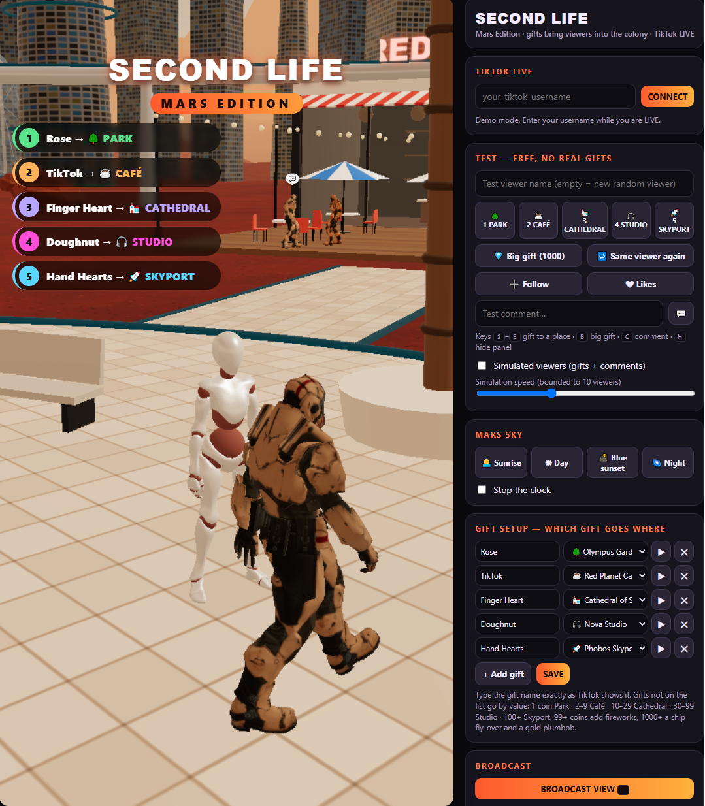
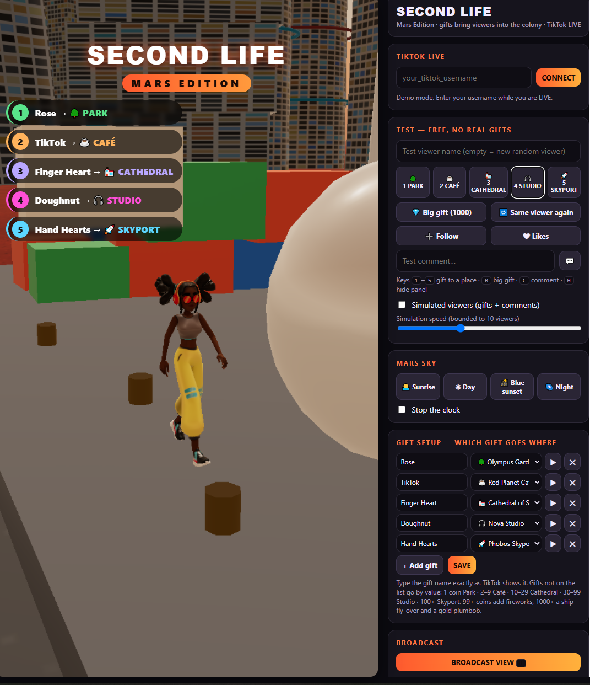

# SECOND LIFE — Mars Edition

A living, Sims-style Mars colony for portrait TikTok LIVE. Colonists walk around, meet up in pairs and groups, chat with icon bubbles, and talk throughout every district. **A gift brings the viewer into the colony**: a teleport beam lands at the place that gift belongs to, a 3D body appears with a green Sims plumbob and the viewer's TikTok profile picture above its head, and the camera flies in for a close-up of their face. When they gift again, the camera zooms back onto their face. A gift for a different place teleports them there.

Built with **Three.js** (real 3D, rigged and animated characters, shadows, bloom) and the same local LIVE bridge as The Last City. The characters are four animated bodies: a woman, a man in a suit, an armoured Mars trooper, and an android. Each viewer always gets the same body, with outfit or armour colours that vary.

## Screenshot

Another colony character and studio view

## The five places

| Gift (default) | Place | What happens there |
| --- | --- | --- |
| 1 · Rose | 🌳 **Olympus Gardens** | Park under a glass canopy: trees, glowing bio-trees, a pond, flower beds, benches |
| 2 · TikTok | ☕ **Red Planet Café** | Terrace with tables, parasols, string lights and a glass-front café |
| 3 · Finger Heart | ⛪ **Cathedral of Stars** | Glass cathedral with twin spires, stained glass, rose windows, pews and a star hologram |
| 4 · Doughnut | 🎧 **Nova Studio** | Open-air studio with a live LED wall, light-up dance floor, moving spotlights and ON AIR podcast pods. Viewers arrive and meet other colonists |
| 5 · Hand Hearts | 🚀 **Phobos Skyport** | Landing pad with a spaceship that takes off and lands, control tower, rover and cargo |

Gifts that are not on the list go by value: 1 coin Park, 2–9 Café, 10–29 Cathedral, 30–99 Studio, 100+ Skyport. 99+ coins add fireworks; 1000+ adds a ship fly-over and a **gold plumbob**.

Around them: a central plaza with a holographic Mars globe and fountain, a futuristic skyline with lit windows, sky bridges and habitat domes, a maglev train ring, flying traffic, red dunes and crater mountains. The sky runs a full Mars day every 8 minutes: butterscotch daytime, **blue Martian sunset**, starry night with Phobos and Deimos.

## How viewers play

| Viewer action | Effect |
| --- | --- |
| 🎁 Gift | Enters (or teleports) to the gift's place · close-up of their face with name, gift and place · hearts |
| 🎁 Gift again | Camera zooms on their face again (same place) or follows them to the new place |
| 💬 Comment | Their character says it in a speech bubble. Viewers without a character join the plaza (max one new walk-in every 1.5 s) |
| ➕ Follow | Joins the plaza and waves |
| ❤ Likes | Hearts above their character |
| ↗ Share | Rockets above their character |

Up to 24 people are on screen by default. When the colony is full, a random background colonist leaves to make room for a viewer.

**The camera** tours the colony on its own between gifts: slow swings over each place, high shots of the skyline, following someone walking, circling a conversation, or visiting a viewer already in the colony. Gift close-ups always come first. If many gifts arrive together, the close-ups get shorter (at most 8 wait; a new gift from someone already waiting extends their turn).

## Start on Windows

Double-click **START-MARS.bat**. Keep its window open while you play; the browser opens at **http://127.0.0.1:3360**. Node.js 22 or newer is required; the first run installs the packages (Three.js, Express, the TikTok connector).

Or from a terminal: `npm install`, then `npm start`. Run the checks with `npm test`.

Use Edge or Chrome with hardware acceleration on. If the stream PC struggles, add `&q=low` to the address (720 × 1280, fewer colonists).

## Connect TikTok LIVE

1. Go LIVE on TikTok.
2. Type your username in the panel and press **CONNECT**.
3. Capture the game: press **BROADCAST VIEW** (or **H**) and capture the window, or add an OBS / LIVE Studio browser source at **http://127.0.0.1:3360/?broadcast=1** at 1080 × 1920.

Test buttons, the gift list and simulated viewers go through the local server to every open view, so the panel page also drives the OBS source. The connector (`tiktok-live-connector`) is unofficial; set `TIKTOK_SIGN_API_KEY` before starting if your signing service needs one. The bridge listens only on 127.0.0.1.

## Host panel

- **Test**: one button per place (keys **1**–**5**), big gift (**B**), "same viewer again", follow, likes, and a test comment (**C**). Type a test viewer name to repeat the same person; leave it empty for a new random viewer.
- **Simulated viewers**: random gifts, re-gifts and comments to rehearse the show.
- **Mars sky**: jump to sunrise, day, blue sunset or night, or stop the clock.
- **Gift setup**: type the gift name exactly as TikTok shows it, choose its place, **SAVE**. ▶ tests that gift. The list is saved in `data/gift-map.json`.

## Files

`server.mjs` local LIVE bridge · `public/rules.js` places, gift list, shot timing · `public/js/world.js` colony, sky, effects · `public/js/people.js` characters, walking, conversations, plumbobs and tags · `public/js/director.js` camera · `public/js/retarget.js` shares the android's animations with the other bodies · `public/assets/models/` the four characters ([credits](public/assets/models/CREDITS.md)).

## Walking town and performance

Colonists walk between districts, stop in spaced conversation circles and sometimes continue chatting on a short stroll. Movement resolves body overlaps and prop collisions, including standing characters. Automatic dancing is disabled.

The default is 540 × 960 at up to 30 FPS, without bloom or shadow passes. Add `?q=high` for 1080 × 1920 with bloom and shadows. Hidden views pause rendering and simulated events. Default crowd limit: 24 bodies. Simulation reuses ten viewer names, emits at most one event every two seconds, and uses small gifts. Effects are bounded. Reflection maps are reused in the default mode, and refreshed at most once per minute in high quality. Camera tours favour wider walking and conversation views; gifts retain face portraits.
