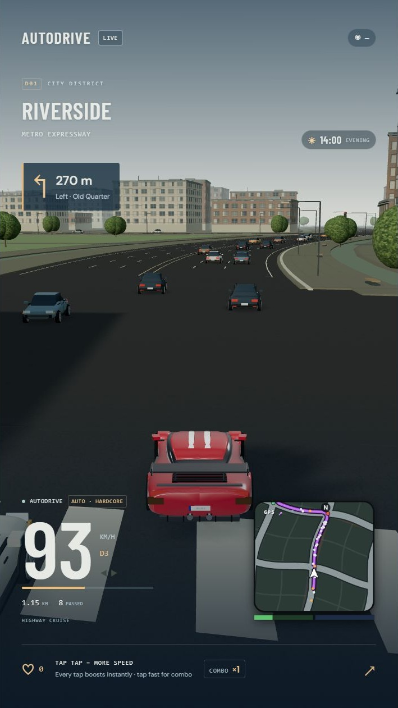

# Autodrive Live

An autonomous open-city driving game for a 9:16 TikTok LIVE broadcast, built with Three.js and a local Node.js bridge. Version 2 uses an original matte Atlas S4, varied original traffic models, a detailed district map and interpolated motion.

## Screenshot




## What's new in v3.1 — curved city, GTA-style radar, indicators

- **The roads are no longer ruler-straight.** The whole city is drawn through one smooth bend of the map (`public/js/warp.js`): avenues and cross streets snake left and right (swing of tens of metres, tightest bend ≈ 300 m), junction corners meet at varying angles and buildings follow the street line. The driving simulation itself is unchanged (exact lanes, signals and collision checks), and the bend never folds, so what does not touch in the simulation never touches on screen. Cars, camera, sun/shadows, light pools and the minimap all use the same warp. Long flat pieces (roads, pavements, kerbs, markings, rails) are cut into 12 m tiles so they bend smoothly.
- **GTA-style radar.** The minimap turns with the car (heading-up), shows the curved streets, a purple GPS route, a white player arrow, an N marker on the edge, traffic-light dots, traffic blips (amber when a car is indicating) and two bars under it (green = pace, blue = boost). The world map (**M**) uses the same curved streets, north-up.
- **Indicators and keep-right.** When the autodrive car is in the second or third lane and the first lane (rightmost) is free and not slower, it **indicates right for ~1.5 s, re-checks the gap, then moves back to the first lane** ("SIGNALLING RIGHT" → "KEEPING RIGHT"). Overtakes also indicate first (0.45–0.75 s). Amber indicator lamps blink at 1.4 Hz on the front corner, mirror and rear of VELOCE R and Atlas S4; the HUD shows green ◀ ▶ arrows like a dashboard. Traffic cars blink while changing lanes and indicate before keeping right.

## What's new in v3

- **Auto camera director (default).** Alternates the behind-the-car chase view and the isometric view with a short dip-to-black cut: about 16 s behind the car, about 11 s isometric, and it switches to isometric early when a turn is coming so the corner is seen from above. Choose Auto, Chase, High or Isometric in the control room.
- **Isometric camera.** A third camera: a true orthographic isometric view (35.26° from above, 45° to the road) like a classic isometric city game. It turns in 90° steps at corners, sits over the oncoming lanes so buildings rarely hide the car, and zooms out with speed. Switch it in the control room (05 Camera), with **C**, or by double-clicking the game. MCP: `set_camera` with `{"camera":"auto"}`, `"chase"`, `"high"`, or `"iso"`.

- **VELOCE R supercar for the autodrive car.** An original, unbranded mid-engine supercar (racing red, twin stripes, rear wing, forged wheels, yellow calipers, clearcoat paint with reflections). Two car cards in the control room switch the autodrive car between VELOCE R and Atlas S4; traffic is unchanged. MCP: `set_car` with `{"car":"veloce"}` or `"atlas"`.

- **Day and night by the real clock.** The sun position is computed from the computer's clock (NOAA solar equations, 45°N and the timezone's longitude by default). Sunrise, sunset, twilight colours, stars, moon, lit windows, glowing shopfronts, street-lamp light pools, headlights and taillights all follow it. The control room's **Time of day** switch can preview Day or Night for everyone; **Real clock** is the default. `?time=21:30` previews a time in one view; `?lat=44.43&lon=26.1` sets an exact location.
- **Super fast mode** (up to ~290 km/h on open highway) and **Auto pilot** (default), which picks the pace from road type, traffic and daylight and switches into Super fast on clear highway with a "SUPER FAST MODE ACTIVATED" banner.
- **Better tap-tap speed.** Every like adds boost immediately (0.05 s per tap, 100 taps = 5 s). Tapping fast builds a combo (×1.25, ×1.5, ×2) that multiplies the boost time and raises boost top speed. **T** sends test taps.
- **Avoid, don't collide.** Traffic now changes lanes smoothly, keeps right, and gives way to the fast autodrive approaching from behind. Forward sensing reaches 640 m; desired speed never exceeds what can be stopped within it. Tests check body overlap for the autodrive and for every pair of traffic cars.

## Start on Windows

Double-click `START-AUTODRIVE.bat` (the previous launcher also works), or run:

```powershell
cd C:\Users\Dexter\Desktop\projects\tiktok\nightdrive-live
npm install
npm start
```

- Control room: http://localhost:4316
- Clean portrait game: http://localhost:4316/?capture=1
- Local MCP endpoint: http://localhost:4316/mcp

In OBS, create a Browser Source using the portrait URL, width **1080**, height **1920**, and 60 FPS if the computer supports it. Keep the server running. The control room can stay open in another window. Each game view currently runs its own deterministic simulation from page load; do not reload the broadcast source during a stream. Likes, boosts, mode, and route preference are shared through the server. The first connected game view supplies MCP telemetry; `telemetryAgeMs` identifies stale readings.

## Controls and interactions

- **Auto pilot (default):** chooses Safe, Fast, Hardcore or Super fast automatically. At night in the city it drives safe.
- **Safe drive:** lower target speeds and longer following distances.
- **Fast lane:** faster cruise and more assertive safe-gap overtakes.
- **Hardcore:** high target speeds and tighter headway, with the same collision and red-light constraints.
- **Super fast:** ~290 km/h highway cruise, quicker lane changes and long-range overtaking, with the same collision and red-light constraints.
- **Explore / Highway / City:** replans beyond the current visible section. The chosen road type begins after approximately 500–800 m; nearby traffic and the current road remain continuous. Turns are selected randomly from valid north/east/west grid connections, without U-turns or self-intersections. The city is fictional, not GPS data.
- **Tap tap:** test 10 likes. Every like boosts instantly; fast tapping builds a combo up to ×2.
- **Rose / Turbo:** test five- and fifteen-second boosts. These buttons simulate events; they do not purchase or send TikTok gifts.
- **Space:** test a turbo boost. **C** or double-click the game: switch camera height.
- **M** or click the minimap: open the world map. Its +/− controls zoom the map; **Escape** closes it. Districts, canal cells, traffic signals, current location and the planned route use the same world coordinates as the 3D scene.
- Optional synthesized engine audio is off until enabled.

Boost time stacks up to 60 seconds. Boosts raise desired speed; they do not override obstacle braking, turn speed limits, red lights, or available lane gaps. Test buttons remain available while LIVE is connected and contribute to the session counters.

## TikTok LIVE

Enter the creator's username in the control room while that account is LIVE. The bridge receives likes, gifts, and viewer counts through the unofficial `tiktok-live-connector`. Cumulative gift streaks are counted once on completion, with bounded deduplication. Gifts grant 5–30 seconds based on gift metadata, not a cash-value claim. No viewer totals or gift activity are fabricated in demo mode.

A real account connection has **not** been verified in this prototype. TikTok changes or a signing-service requirement can prevent connection; failures appear in the control room. If your connector provider requires a signing key, supply `TIKTOK_SIGN_API_KEY` in the server environment. No session cookies are collected. See the [connector documentation](https://ttlc.docs.isaackogan.com/configuration/options/).

## Autonomous driving

The driver uses SI units and a fixed 60 Hz timestep. Longitudinal movement uses an Intelligent Driver Model style acceleration controller with time headway, relative velocity, comfortable braking and an independent stopping-distance envelope. Adjacent lanes are evaluated against front and rear gaps; the lateral transition uses a quintic interpolation with zero endpoint velocity and acceleration. Corners use quintic Bezier curves with zero curvature at their straight-road joins and sufficient radius to keep the offset lanes moving forward. Arc-length samples are reconstructed with continuous Hermite tangents. Lookahead curvature limits corner speed before the turn. Red signals act as stationary leaders. A final bumper-gap clamp protects the modeled lane corridors when the preceding car brakes suddenly. Cross traffic traverses city junctions only during the red phase and clears before green.

The speedometer and odometer account for the offset lane's arc length and lateral travel. Lane-change progress follows forward speed, so stopping for traffic also pauses sideways motion. The renderer interpolates the previous and current physics state independently of screen refresh rate. The chase camera damps both position and orientation. Its field of view stays fixed. Normal requestAnimationFrame scheduling is primary; a dedicated timer worker recovers rendering if Chromium throttles an occluded embedded preview while its document is still visible. Recovery remains active until animation callbacks have been stable for twelve frames. The FPS counter measures rendered frame calls, including recovery calls; screen presentation and OBS capture can impose their own limits. Background documents pause deliberately.

The world streams a bounded 5×5 set of city blocks, prunes old route samples, and uses a floating render origin. Block plans are generated in a worker and committed one per frame. Instanced traffic and city geometry reduce draw submissions. Road runs end at junction boundaries, eliminating overlapping asphalt surfaces. Directional shadow coverage is aligned to a fixed world texel grid; cars use contact shadows. Bloom, clearcoat and reflective environment lighting are absent.

The fictional districts are **Riverside**, **Old Quarter**, **Central Heights**, and **East Works**. Their architecture includes textured masonry, pilasters, balconies, shopfronts, service alleys, rooftop equipment, stepped towers, warehouses, parks and canal bridges. The original vehicles are smooth lofted bodies with window pillars, mirrors, grilles, door details, squared lamps and modeled wheels. This remains a procedural browser game with simplified vehicle dynamics. The map is fictional, and passing the modeled safety checks is not a proof covering every possible traffic scenario.

### Game modules

| Module | Responsibility |
| --- | --- |
| `simulation.js` | Lane planning, route curves, traffic, lights, acceleration and safety constraints |
| `motion.js` | Fixed physics clock and frame interpolation |
| `frame-pump.js` | Browser frame scheduling and occlusion recovery |
| `world.js` | WebGL rendering, camera, traffic transforms, stable lighting |
| `vehicles.js` | Original matte vehicle geometry and instancing templates |
| `city-plan.js` / `city-worker.js` | Deterministic district generation off the render thread |
| `city.js` | Materials, textures and streamed GPU instances |
| `navigation.js` | GTA-style heading-up radar and zoomable world map |
| `warp.js` / `warp-shader.js` | Curved-city bend: one smooth map used by JS (cars, camera, radar) and by every shader |

The optional `/?qa=turn` URL starts a local visual check before the first city bend with traffic spawning disabled. Normal studio and broadcast URLs use the full game. Render telemetry includes FPS, frame time, draw calls, geometry counts and render CPU time; this is diagnostic data, not a guarantee for every machine or capture setup.

## MCP

Stateless HTTP MCP, protocol `2025-03-26`, JSON responses at `http://localhost:4316/mcp`. Supports initialization, notifications, `ping`, `tools/list` and `tools/call`:

| Tool | Arguments |
| --- | --- |
| `get_drive_state` | `{}` |
| `set_drive_mode` | `{"mode":"auto"}`, `"safe"`, `"fast"`, `"hardcore"`, or `"superfast"` |
| `set_camera` | `{"camera":"auto"}`, `"chase"`, `"high"`, or `"iso"` |
| `set_car` | `{"car":"veloce"}` or `"atlas"` |
| `set_time_of_day` | `{"clock":"real"}`, `"day"`, or `"night"` |
| `set_drive_route` | `{"route":"mixed"}`, `"highway"`, or `"city"` |
| `trigger_boost` | `{"seconds":15}`; range 1–30 |

This endpoint is available for you to add to an MCP client; no global client settings are changed. The bridge binds to loopback and validates browser origins. It is intended for local broadcasting, not public hosting.

## Verification

```powershell
npm test
```

Seventeen tests cover the curved-city warp (no folds, real bends, exact shader phases far from the start), indicate-then-keep-right for the autodrive and traffic, overtakes that indicate before moving, super-fast highway driving (pace judged over three seeds) with traffic lane changes, real-clock sun positions, 50 km of route sampling/pruning, ten simulated minutes per driving mode with repeated boosts and both lane-distance and world-space oriented-body collision checks, continuous turn headings, forward motion through offset corners, consistent physics at 30/60/144 Hz, non-overlapping road slabs, red-light braking, gift streak deduplication, boost timers, HTTP modules, WebSocket events, MCP controls and origin rejection.

Original asset details: [public/assets/CREDITS.md](public/assets/CREDITS.md). Interface fonts use Google Fonts with system fallbacks; game geometry and textures are local. The retired imported car and its attribution are archived in `artifacts/` and are not served by the game.
