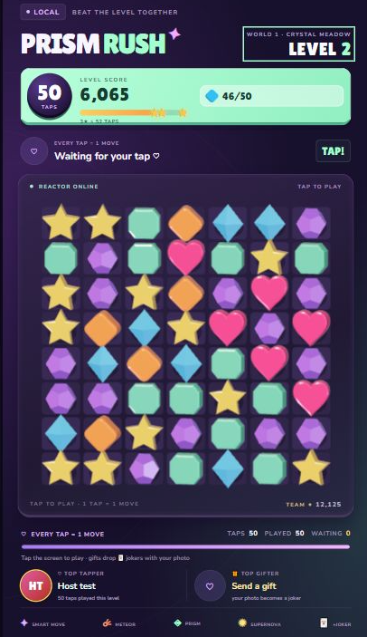

# Prism Rush — TikTok LIVE match reactor

A viewer-controlled 3D match game in a 9:16 capture frame. Made with Three.js, JavaScript and a local Node.js session server. All pieces, lighting, powers, particles and animations are generated in code; Blender is optional for future custom models.

## Screenshot




## Start

1. Install Node.js 22 or newer if it is not already available.
2. Double-click **START.bat**. It opens a portrait game window using Edge or Chrome. No npm install or build is needed.
3. Press **H** for host controls, or open **HOST-CONTROLS.bat** while the server is running.
4. Press **F** for fullscreen. **Space** pauses/resumes; **1–4** test the four powers; **T** adds 25 test taps.

You can also tap/click the gem board or the team charge meter. Each direct tap contributes one local test tap and immediately emits a small sparkle. Taps are batched every 120 ms before reaching the game. The desktop “Tap tap” test button adds 25 taps at once. Real TikTok taps still arrive through the relay. Every tap is one move. Press **M** (or click the level label) to open the level roadmap.

The game: http://localhost:4328/ · Host: http://localhost:4328/host

For OBS or LIVE Studio, add the browser source `http://localhost:4328/?capture=1` at **1080 × 1920**, **60 FPS**. It displays only the portrait game. Capture the app window instead if your streaming application does not support browser sources. Keep the Node server running throughout the stream.

The wide browser layout includes test controls. On narrow screens the game occupies the available portrait frame; use H or the separate host panel for controls. Audio starts muted; the musical-note button enables synthesized sounds.

## Viewer participation

**The game only moves when viewers act. There is no autopilot.**

| Viewer action | Result |
| --- | --- |
| Tap (like) | **One tap = one step**: exactly one random legal swap. Its match explodes and the gems above fall, then the board stops — nothing continues by itself. New gems never land in a line (calm refill); a line made by gems sliding down waits and explodes with the next step. Taps that arrive faster than the board can play wait in the counter and play fairly between viewers (round-robin). |
| Rose | Smart steps: the best swap for the level goals, one step at a time, at full points. Drops a 🃏 joker. |
| Finger Heart / GG | Meteor: the best 3 × 3 nova blast, then smart steps. Drops a joker. |
| Heart | Prism: clears the best (or chat-voted) color **inside a 5 × 5 area** (never the whole board), then smart steps. Drops a joker. |
| Galaxy | Supernova: clears a **5 × 5 area** at the best spot (never the whole board), then smart steps. Drops a joker. |

**Gift steps (automatic, by value).** A gift plays `1 + floor(log2(coins))` automatic steps, at most 12: 1 coin = 1 step, 5 coins = 3, 30 = 5, 100 = 7, 1,000 = 10. A power gift uses its first step for the power; the rest are smart swaps. Gift steps play before waiting taps, alternating between gifters, one step at a time.
| Chat a color name | Vote for the next prism target: red, orange, yellow, green, blue or purple. |

**Jokers (gift reward).** Every accepted gift unit queues one joker showing the gifter's TikTok profile photo. A joker is wild, like a joker in cards: it counts as any color in a line (R R 🃏 B B clears all five) and explodes like any other piece. Three jokers alone do not match. Jokers enter with refills (each new tile has a 30% chance while jokers are waiting). There are never more than **5 on the 56-cell board (8.9%)**; in practice about 1 is on the board at a time. An exploding joker pays its gifter **+500 points**. The next 60 jokers are stored as individual pieces; additional gifts wait as compact per-viewer counters. Long streaks do not lose jokers. Jokers left on the board when a level ends or a recovery rebuild is needed go back to the waiting list. The waiting count includes all of them and survives restart.

**The tap counter.** The screen shows TAPS / PLAYED / WAITING. At every moment, *received = played + waiting*; the tests check this continuously. Each tap plays exactly one swap, even with a backlog; a busy queue only speeds the animation up a little (up to 1.5×). Taps beyond what the board can play wait in the counter, are never lost, and play in order. The side-panel **Tap tap** button and the T key send exactly 1 tap.

**Points.** Tap steps earn a quarter of the wave score (taps are plentiful, so points are harder to get). Gift steps earn full points.

**Viewers in the game.** Viewer photos (from the relay's `user.avatar`) appear on joker pieces, next to the active player, as TOP TAPPER and TOP GIFTER of the current level, on the level-complete screen (top tapper, MVP, top gifter), and beside every completed level on the roadmap. Photos go through the local server (`/api/avatar`): only https links on TikTok image servers, no redirects, images up to 500 KB, 400 cached. Without a photo, colored initials are shown.

An active viewer's name appears above the board; host tests show “TEST”. Automatic simulated viewers are removed, including from older saves. Connecting a relay clears test participants, their queued taps, gift powers and jokers, and removes test taps from the displayed ledger. Reconnects preserve real viewers' input. Level heroes count taps and gifts when they play, so waiting actions earn recognition in the level they actually help.

## Real TikTok connection

The local edition uses the relay already installed in the sibling `turbo-autostrada` project. Start that relay separately:

```powershell
cd C:\Users\Dexter\Desktop\projects\tiktok\turbo-autostrada
node server.js YOUR_TIKTOK_USERNAME
```

In Prism Rush host controls, enter its WebSocket URL, normally `ws://localhost:3000/ws` (use the relay's printed port), check the gift mappings, and select **Connect relay**. “Relay connected” and “TikTok LIVE” are separate states. A running relay does not prove the selected account is on air. No TikTok password is requested by this game.

This adapter accepts the existing relay's `{type:'batch',events:[...]}`, `status`, `like`, `gift` and `chat` packets. That relay reports gift-streak deltas in `coins`; `total / repeat` identifies the unit value. Zero-value final packets grant nothing. Repeated units are retained as queued actions and rotated fairly with other viewers' actions. This is not a direct adapter for arbitrary raw TikTok/TikFinity payloads.

The relay preserves complete positive integer like counts (including packets above 500), ignores duplicate message IDs, and reads photos from the connector's image URL formats. The counter covers events delivered by the relay; events not delivered by TikTok or missed while disconnected cannot be reconstructed. Restart the relay after updating its code.

The existing relay uses the [unofficial TikTok Live Connector](https://github.com/zerodytrash/TikTok-Live-Connector). Its ability to receive real events depends on TikTok and the relay configuration. An actual on-air account test remains necessary.

## Level roadmap (Candy Crush style)

**150 levels in 10 worlds** (Crystal Meadow → Diamond Crown); after level 150 the last five worlds replay as an endless encore. A level has 1–4 goals (collect gems of a color, break all ice, reach a score, create beams/novas) and **no move limit**: it ends only when the goals are met, so it can always be finished. Every fifth level is a ☠ hard level with combined goals and about 30% more taps.

Flow: level intro → viewers tap and gift → goals done → level complete (stars, top tapper, MVP, top gifter with photos) → animated roadmap with the heroes → next level. Taps that arrive during these screens wait in the counter and play afterwards.

**Stars measure tap efficiency**: 3 stars if the crew needed no more taps than the fastest 25% of simulated random-tap runs, 2 stars within the fastest 60%, otherwise 1. Gift powers use no taps, so gifts help earn stars.

### How the levels were made

The levels are designed around measured random-tap rates in step mode: per tap about 3.85 gems cleared, 0.64 of each color, 0.061 beams, 0.014 novas and 66 points; about 16% of steps explode a line left waiting by sliding gems. Intended length is `50 + 9 × (level − 1)` taps (+30% on hard levels). Goal size = rate × taps × share. Measured medians: about 47 taps on level 1, about 480 on level 60, about 1,100–1,250 on levels 140–150.

`npm run calibrate` (tools/calibrate-levels.mjs, uses all CPU cores, about 5 minutes) plays every level 16 times from different seeded boards with random taps only. It stores the 25th / 60th / 50th / 90th percentile of taps needed; these give the star thresholds and the numbers shown on screen. Rerun the tool after changing goals.


## Match mathematics

- Board: **7 columns × 8 rows**, six gem colors, optional ice layers under cells. Only orthogonally adjacent swaps are allowed. Invalid swaps do not alter the board or random generator.
- **3 in a row/column:** clear the matched cells.
- **4 in a line:** preserve one anchor and create a beam in that line's direction.
- **5 or more in a line:** create one prism. This takes priority over an intersecting match.
- **T/L/cross intersections:** merge overlapping runs and create one nova. Each cleared cell is counted once.
- **Beam:** clears its row or column. **Nova:** clears its clipped 3 × 3 area. **Prism:** clears the voted color, or the most common color if there are no votes. A prism swapped with a normal gem clears that gem's color.
- Two adjacent powers may be swapped without a color match. Beam combinations clear crosses, nova combinations use radius two, and double prisms clear the board. Hit powers chain once each. New power anchors survive their creation wave.
- After each wave, survivors retain their order within each column, fall into the lowest available cells, and new gems form a contiguous column immediately above the board. A single vacancy drops one new gem by one row. Refills use a seeded xorshift generator. Planning copies never consume the live generator.
- A stable board without legal moves is visibly reforged. Cascades have a safety bound of 32 waves before explicit stabilization. These recovery actions do not invent points.

Wave score: `60 × cleared cells × min(cascade index, 12) + 180 × activated powers + 240 × created powers`. Scores support millions and continue across rounds; safe-integer saturation prevents precision overflow.

## Level heroes, chests and long sessions

Level completion waits for an active cascade to settle, so a viewer always receives all their points before the heroes are chosen. The MVP (most points in the level) earns an in-game trophy. Ties use viewer ID order. No cash, physical prize or random prize drawing is implemented.

Every 500 cleared gems unlocks a shared team chest. Lifetime score, chests, trophies, stars per level, unlocked level, current level progress and ice, queued actions, board, seeded generator and active animation save to `data/session.json` every five seconds and on graceful shutdown. Older saves (versions 1–2) keep lifetime score, viewers and chests and start the 150-level roadmap at level 1. The tap counter and waiting jokers are saved too. The last eight level MVPs are retained. Host controls can complete (test), restart, skip or jump to any level. Abrupt power loss may lose the most recent five seconds.

All local game windows, browser capture sources and host controls observe **one authoritative server session**. The browser renders between 20 Hz state snapshots; opening a second view does not duplicate actions. Disconnects retry every five seconds while the reactor continues locally. Pause preserves pending actions and phase timing, including elapsed time when resuming a saved drop.

Limits: 5,000 participants; 512 queued action groups; 14 recent internal log events; 640 particle slots; eight shockwave slots. Large repeated gift/tap charges coalesce into action units. Queue overflow is reported in the signal log. Under sustained overload the queue can become long; its current size is visible above the board.

## HQ animation (v3.1)

Renderer-only polish; game rules, step timings and the 1 tap = 1 move count are unchanged.

- **Swaps** use anticipation (a short pull-back and squash), an overshoot-and-settle arc and stretch along the direction of travel; one gem passes over the other.
- **Falling gems** stretch with speed, squash on landing and kick up a small dust puff after long drops.
- **Matches** swell and shiver for a moment, then spin-implode while 3D crystal shards, star sparkles and a white-hot flash fly out; a soft shockwave marks the centre of normal matches. Jokers burst in gold.
- **Idle life**: a slow breathing wave across the board, star twinkles on random gems, a moving key light for living reflections, spinning prism gems, pulsing halos, shimmering beam lines and an occasional coin flip on jokers.
- **Level complete**: tumbling ribbon confetti over the result card and in the board.
- Every effect uses a fixed instanced pool (one draw call each) and turns off with the system's reduced-motion setting.

## Hosted demo

The private hosted version is a standalone browser demo, clearly marked **HOSTED DEMO**. It also waits for manual taps or test gifts; it does not invent viewers or actions. A module Web Worker runs the simulation and candidate searches separately from Three.js rendering. It saves to that browser's local storage; separate tabs run independent demo sessions. Real TikTok connection and shared host controls require the local server. The hosted version never tries to reach your computer's relay.

## Performance and validation

The renderer uses shared geometries/materials, instanced grid/shadows/particles/glows/streaks, fixed effect pools, no realtime shadow maps, no postprocessing, capped pixel ratio and automatic resolution reduction after sustained slow frames. Gem cuts have stronger bevel shading; explosions add colored shard bursts, sparks, localized glow, beam clears and prism rays. Meteors have a visible incoming comet. Reduced-motion settings suppress shake and bright secondary effects.

The shared motion model uses a calmer step pace: **300 ms swap**, **320 ms burst**, **600 ms gift power**, and a **260–700 ms distance-based drop including spring landing**; a busy queue plays at most 1.5× faster.

`npm test` runs 66 current-project tests (the backup directories are excluded). Coverage includes one-tap-one-step play with no automatic chains, calm refills, gift steps by coin value, 5 × 5 gift areas, the exact tap ledger, fresh/legacy-save inactivity, batches above one million taps, fair queuing, transition attribution, all 150 calibrated levels, long gift streaks with compact joker storage, the five-piece board cap, supernova/joker persistence, scoring and forecasts, all match and power types, gravity, a two-hour accelerated session, server/shared-state behavior, the hosted worker, and a mock WebSocket relay. Run `node --test tests/relay-input.test.mjs` in `turbo-autostrada` for two additional tests of full like counts and connector photo formats.

The current host controls and portrait game were checked in a local browser using an isolated test session. Real TikTok delivery, real profile-photo retrieval, and performance under a 1080 × 1920 streaming capture still require an on-air check. Restart both Prism Rush (`START.bat`) and the Turbo Autostrada relay to load this update.

`npm run build` copies the self-contained public assets into `dist/` for static hosting. Three.js 0.187.0 and the two fonts are bundled with their licenses. Gameplay requires no CDN, downloaded models or remote image assets.
