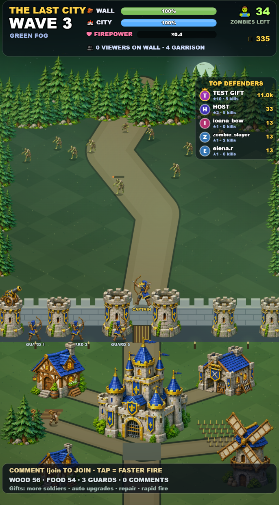
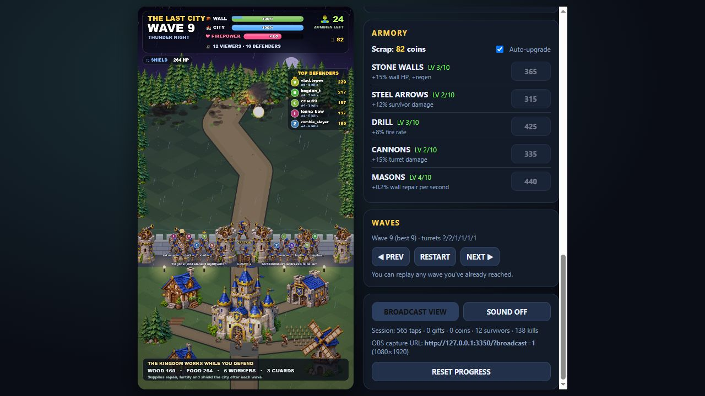
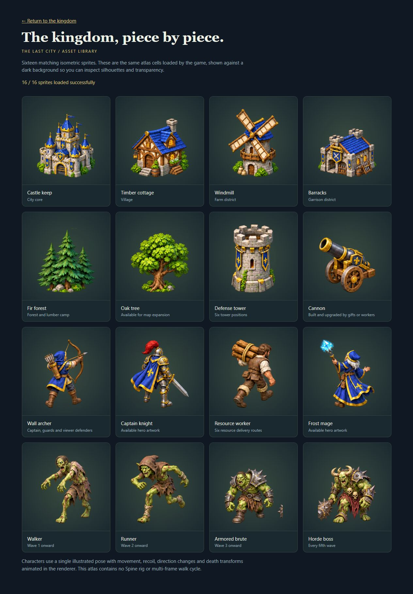
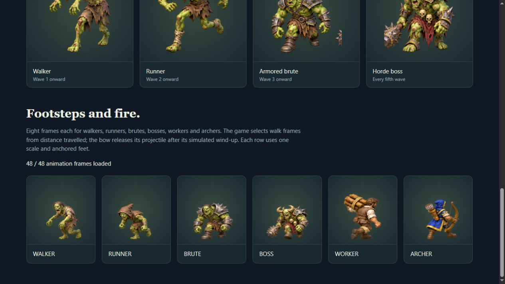

# THE LAST CITY — Zombie Defense LIVE

A 9:16 wave-survival game for TikTok LIVE. Large zombie packs attack a living medieval city. **Comment `!join` to become a defender**, tap to increase firepower, and use mapped gifts to recruit permanent soldiers, upgrade the armory, repair, or launch tactical strikes. Walkers, runners, brutes, bosses, workers and archers have real sprite animation frames.

Built on the same engine as TIMBER RIDGE: the same local LIVE bridge, 100 ms crowd batching, gift streak de-duplication, host gift list, armory with auto-upgrade, and a save that keeps progress between streams. The world now combines a generated blue-and-gold isometric sprite atlas with procedural terrain, roads, lighting and effects. All assets are bundled locally.

## Screenshot

## Gameplay and asset previews

Open **http://127.0.0.1:3350/assets.html** to inspect all sixteen sprite cells on a dark background. `public/assets/manifest.json` records cell order, dimensions and provenance. `docs/asset-prompts.md` preserves the generation prompts. Screenshots above are captured from the running local game, not concept mockups.

## Living kingdom and combat

- **Six workers** travel to the lumber camp and wheat fields, work, and return to the storehouse. Resources only arrive when a worker finishes the return trip. Wood, food and completed delivery totals survive reloads; routes resume at the storehouse.
- **After each successful wave**, masons spend 8 wood per 8% wall repair as needed, then 40 remaining wood funds one cannon build or upgrade. Twelve food supplies an 8% wall shield. Stores cap at 9,999 each.
- **Three permanent archers and the captain** start on the wall. An unassisted city is overwhelmed. Recruit gifts add permanent archers up to twelve guards; viewer defenders occupy sixteen additional slots.
- **Combat runs at 60 simulation steps per second.** Render rate does not change the simulation result. Movement accelerates and decelerates, with spatial-hash neighbor separation and a gate waypoint for breached enemies.
- **Projectiles lead moving targets**, travel at fixed velocity, collide with the first enemy along a swept segment, and apply armor and splash damage on impact. Reserved target damage is released after impact or expiry so a miss cannot make an enemy untargetable. Cannonballs use a visual ballistic arc over their ground trajectory.
- **Cinematic, overview and battle camera modes** ease between bounded views. Mouse-wheel zoom keeps the HUD fixed. RESET ZOOM returns to the cinematic default.
- **Generated art:** castle, cottage, windmill, barracks, fir trees, oak, tower, cannon, archer, knight, worker, mage, walker, runner, brute and boss. The oak, knight and mage are available artwork in the asset library; the other thirteen assets are used in gameplay.

`character-cycles.png` adds **48 frames**: eight each for walker, runner, brute, boss, worker and archer. Walking follows actual distance travelled, stops with the unit, and uses a fixed scale and individual foot anchors. Archers wind up for 0.18 seconds and launch the projectile at the release pose. These are raster animation cycles, not Spine rigs or a 3D renderer. Static buildings remain in the original atlas.

Ambient torches have fixed 36 px halos at 7.5% opacity. They do not flicker, grow or move. Shields have a steady faint edge; storm lightning and combat full-screen flashes are disabled. Impact shake stays within 1.2 canvas pixels.

### Participant roster

**WHO IS IN THE CITY?** shows users, LIVE / DEMO / TEST source, wall/queue/idle status, and per-user comments, raw likes, gifts and kills. Search by name. Watching viewers from TikTok are shown separately; an observed participant is not the same thing as a watching viewer. Historical scores and NPC guards are not counted as current participants. The in-game TOP DEFENDERS list shows current wall defenders using their session score.

Totals count comments processed by the local bridge. Comment bonus taps are rate limited, but all processed comments are counted. Raw likes remain separate from effective, audience-scaled firepower taps and comment bonuses. Large like batches retain top contributors, with remaining likes unattributed; the UI does not invent users for them.

Host and OBS pages receive the same control and LIVE events, but each runs its own simulation and browser-local save. They are not an authoritative synchronized multiplayer session; use a single game view as your broadcast source.

### Wave flow
1. **Wave card + GIFT MENU** (3 s): the wave, how many zombies (and bosses), and your gift list, so viewers know what each gift does.
2. **3 · 2 · 1 · DEFEND!** Zombies only enter after the countdown.
3. **Fight.** Survivors, the captain and the turrets shoot automatically. Taps make everyone shoot faster.
4. **Wave survived:** a summary shows the time, coins, the **MVP** (most kills) and the top tapper. After 5 s the next wave starts.

**If the wall falls,** zombies pour through the gate toward the castle. **If the castle falls,** the city regroups at the last checkpoint wave (1, 6, 11, …): turrets lose one level and that wave's horde is 20 % weaker next time (down to 40 %), so a stream can never be stuck forever.

Between waves, BUILD gifts (recruit, upgrade, repair, turret, barricade) work immediately. COMBAT gifts (rapid fire, freeze, meteors, dragon fire) are saved and fire 4 s after the next GO. Recruitment at the guard limit becomes shield; upgrade gifts at maximum armory become shield.

Five nights rotate: **Moonlit Siege, Blood Dusk (embers), Green Fog, Thunder Night (steady rain), Frozen Horde (snow)**. A boss arrives every 5th wave.

## Start on Windows

Double-click **START-LAST-CITY.bat**. Keep its window open while you play; the browser opens automatically at **http://127.0.0.1:3350**. Node.js 22 or newer is required, and the launcher installs missing packages on the first run.

Or from a terminal: `npm install`, then `npm start`. Run the checks with `npm test`.

## Connect TikTok LIVE

1. Go LIVE on TikTok.
2. Type your username in the panel and press **CONNECT**.
3. Wait for the "is LIVE" status, then capture the game.

**Capture:** press **BROADCAST VIEW** (or **H**) and capture the window, or add an OBS / LIVE Studio browser source at **http://127.0.0.1:3350/?broadcast=1** at 1080 × 1920. Test buttons, simulated viewers and armory purchases go through the local server to every open game view, so the panel page also controls the OBS source.

The connector (`tiktok-live-connector`) is unofficial. If your signing service needs a key, set `TIKTOK_SIGN_API_KEY` before starting. The bridge listens only on 127.0.0.1.

## How the audience plays

| Viewer action | Effect |
| --- | --- |
| 💬 `!join` / `join` / `play` / `defend` / `intru` | Joins the wall once, or reactivates an idle defender |
| ❤ Tap / like | Crowd FIREPOWER; an already-joined viewer's survivor shoots 50% faster for 2.5 s. Likes alone do not create a defender |
| 💬 Any comment | Counts as 3 taps (at most once per viewer every 4 s) |
| 💬 "repair" / "fix" / "build" / "repara" | +1.5 % wall (once per viewer every 10 s) |
| ➕ Follow | +8 % wall |
| ↗ Share | +6 s rapid fire |

### Survivors
- The **16 most recently active** viewers stand on the wall (a viewer stays up for 90 s after their last action). The **CAPTAIN** (the host's defender) always holds the gate.
- Three permanent guards join the captain, so the wall has four defenders before the first viewer arrives.
- Each survivor's rank ★1–★10 comes from their leaderboard score, so loyal viewers keep their rank between streams. Rank raises damage (+22 % per rank) and the weapon: **bow** (★1), **crossbow** (★3), **musket** (★6), **hand cannon** with splash (★9).
- Gifters wear a gold cape and a gold ring; the leaderboard leader wears a 👑.

### Gift setup (host panel)
In **GIFT SETUP**, type a TikTok gift name exactly as TikTok shows it (for example `Rose`), choose what it does, and press **SAVE**. Choose **RECRUIT SOLDIER** or **AUTO UPGRADE** to assign either new effect to any gift. The ▶ button tests the currently selected draft action even before saving. The list is saved in `data/gift-map.json` and shared with the OBS view. Default list: Rose = Rapid Fire · TikTok = Repair Wall · Finger Heart = Build Turret · Ice Cream Cone = Freeze · Doughnut = Meteor Strike · Hand Hearts = Barricade · Galaxy = Dragon Fire.

| Action | Effect per gift |
| --- | --- |
| 🏹 RAPID FIRE | +4 s: every survivor shoots twice as fast, turrets 50 % faster |
| 🔨 REPAIR WALL | +25 % wall; rebuilds a breached wall |
| 💣 BUILD TURRET | builds a cannon on an empty tower (6 towers), else upgrades the weakest (max level 5); when all are maxed, +2 s rapid fire |
| 🪖 RECRUIT SOLDIER | +1 permanent guard, maximum 12; excess recruits become +3% wall shield each |
| ⚒ AUTO UPGRADE | +1 armory level immediately, choosing a lowest-level affordable-price-priority stat without spending scrap; maximum armory becomes +5% shield |
| ❄ FREEZE | +5 s: the whole horde stops moving and attacking |
| ☄ METEOR STRIKE | 3 local meteors, 110 damage each in a 105 px elliptical radius; bosses take 60% of meteor damage |
| 🛡 BARRICADE | energy shield worth 40 % of the wall's HP, +15 % repair |
| 🐉 DRAGON FIRE | damage = min(280, 65% of max HP) per normal enemy; bosses lose 20% of max HP; +6 s rapid, +20% wall repair, +15% shield. Healthy enemies survive and the castle is not healed |

**Gifts not in your list** work by coin value: 1–9 = Rapid Fire, 10–99 = Build Turret, 100–999 = Meteor Strike, 1000+ = Dragon Fire.

Timed effects stack up to a cap (rapid fire 25 s, freeze 15 s, shield 100 % of wall HP). Scrap uses **round(5 × sqrt(coin value) × gift count)**, capped at 100,000: a single 100-coin gift gives 50 scrap and a 1000-coin gift gives 158. These tiers are gift values, not enemy counts or wave selectors. TikTok streak replays only count newly received gifts. Different gift names at the same coin value keep their distinct configured actions.

**Scores:** 1 point per effective tap, 10 points per TikTok coin gifted and 2 points per kill. History is saved for ranks; the HUD ranks current defenders by their current-session score.

## The maths

- **Crowd power** decays exponentially, so a steady tap rate settles at **power = 0.1 × taps per second** (10+ taps/s = 100 %). **Firepower** = 40 % + 100 % × power of the base fire rate, so survivors always defend, but the crowd makes them up to 3.5× faster.
- **Big audiences:** LIVE likes are divided by `max(1, viewers × 0.03)`. You can set the scale manually under Audience scale.
- **Survivors:** 1.15 s base cooldown at ×1 firepower plus 0.18 s bow wind-up; 10 damage × rank bonus × armory, range 460 px. The captain hits for 14 with 560 px range. Shorter ranges give the horde room to emerge visibly from the forest before being engaged.
- **Turrets:** 46 damage (+45 % per level) in an 85 px+ splash every 1.7 s, range 500 px.
- **Hordes:** zombies = min(360, 48 + 16 × (wave − 1)), with at most 240 active and the rest queued. Packs of up to 24 arrive from varied entry zones. Runners are guaranteed from wave 2 and at least two brutes from wave 3. Bosses arrive every fifth wave, maximum four. Enemy size grows by up to 45%, speed by up to 60%. Survival pays 80 + 30 × wave scrap plus kill rewards.
- **Difficulty:** with k = wave − 1, HP multiplier = (1 + 0.2k + 0.012k²) × checkpoint relief × fortification pressure. Attack multiplier = (1 + 0.075k) × pressure. Pressure snapshots existing turrets, upgrades and recruited guards at wave start, capped at ×2.2; gifts cannot strengthen an enemy mid-fight.
- **Enemy strikes:** walkers attack every 1.35 s at base 8 DPS; runners 0.85 s / 6 DPS; brutes 1.8 s / 24 DPS; bosses 2.2 s / 95 DPS. Each timed strike deals DPS × interval × wave attack multiplier. Freeze pauses the attack clock and movement rather than accumulating a burst.
- **Wall:** 1,200 HP (+15 % per Stone Walls level). Between waves masons restore part of it; during a fight it regenerates slowly only while nobody is hitting it. **Castle:** 600 HP.
- **Armory** (10 levels each, price = base × 1.45^level): Stone Walls (120) · Steel Arrows (150): +12 % damage · Drill (140): +8 % fire rate · Cannons (160): +15 % turret damage · Masons (100): +0.2 % wall regeneration per second. With **Auto-upgrade** on, the cheapest affordable upgrade is bought repeatedly after every wave.

## Host keys

**Space** tap · **1–4** test gift tiers · **R** "repair" comment · **F** follow · **S** share · **M** sound · **H / Esc** hide or show the panel. Test buttons and simulated viewers are free and never send real gifts.

## Files

`server.mjs` LIVE bridge · `crowd-buffer.mjs` 100 ms event batching (bounded for 10k+ audiences) · `gift-ledger.mjs` streak de-duplication · `public/rules.js` shared numbers · `public/sim.js` wave and combat orchestration · `public/combat.js` intercept and swept collision maths · `public/movement.js` local steering and gate navigation · `public/settlement.js` worker routes and economy · `public/camera.js` bounded camera · `public/assets.js` atlas loader · `public/kingdom-art.js` terrain and city composition · `public/art.js` procedural fallback · `public/game.js` renderer, HUD, audio and host panel · `public/assets.html` sprite inspection · `tests/` checks · `screenshots/examples/` actual game captures.

Validation: `npm test` runs 55 checks covering participant provenance and counts, join commands, gift action mapping, recruitment and upgrades, capped horde queues, exact strike damage, release-frame projectiles, animation selection, HTTP/SSE integration, persistence, and identical 30/60/144 FPS simulation results. `node tools/balance-audit.mjs` compares fresh unupgraded cities at waves 1/3/5/10 with 0/4/8/16 joined defenders and one 0/100/1000-tier gift. Real TikTok LIVE connection requires an active account and is not exercised by offline checks.
