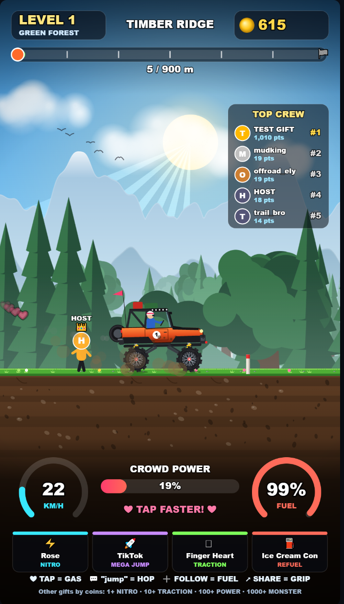
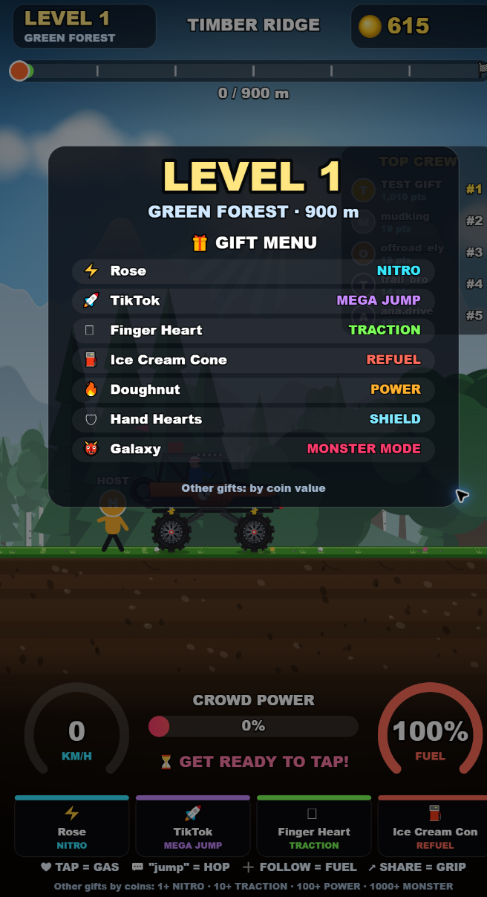
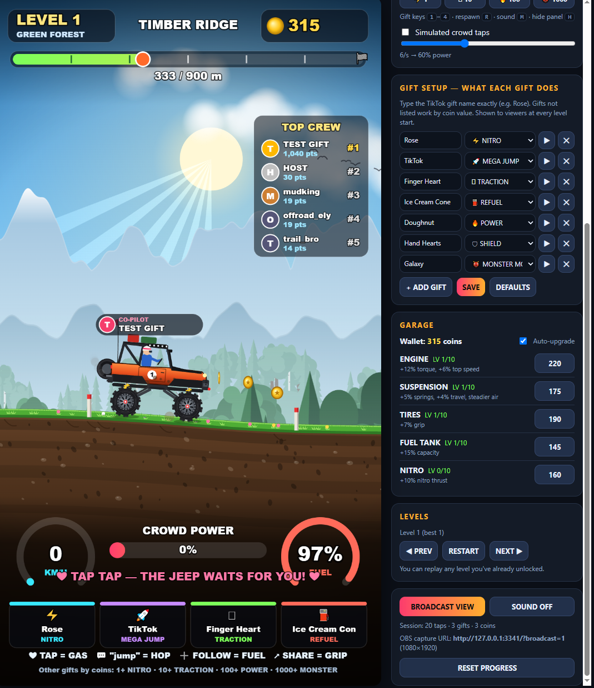

# TIMBER RIDGE — Forest Jeep Hill Climb LIVE

A 9:16 side-scrolling rock-crawler hill climb for TikTok LIVE. A lifted 4x4 monster jeep with huge mud-terrain tyres and long-travel coilovers crawls through forests and mountains: 80° rock ledges, rock staircases, cliff drops, boulder gardens, logs, mud pits and ice. **The jeep never drives by itself: the crowd is the gas pedal.** Taps drive it, gifts give boosts (you choose which gift does what), follows refuel it, chat makes it jump, and every tapper's avatar runs behind the jeep.

## Screenshot

Gift menu and host controls

### Level flow
1. **Level card + GIFT MENU** (3 s): the level, its length, and your gift list, so viewers know what each gift does.
2. **3 · 2 · 1 · GO!** The jeep is locked during the card and the countdown.
3. **Race.** Taps drive, gifts boost.
4. **Finish line:** the jeep brakes to a full stop, all boosts end, and a summary shows the time, coins and the **MVP tapper**. After 5 s the next level starts with its own card and countdown.

While the race is locked (card, countdown, finish), gifts, follows and shares still count toward the leaderboard and coins, but their **boosts are saved and fire at GO**. Nobody loses a gift.

Five hand-tuned worlds rotate as you level up: **Green Forest, Pine Sunset, Autumn Valley, Moonlight Woods (headlights on), Frozen Ridge**. All graphics are generated in code, so there are no image files to download.

## Start on Windows

Double-click **START-TIMBER-RIDGE.bat**. Keep its window open while you play; the browser opens automatically at **http://127.0.0.1:3340**. Node.js 22 or newer is required, and the launcher installs missing packages on the first run.

Or from a terminal: `npm install`, then `npm start`. Run the checks with `npm test`.

## Connect TikTok LIVE

1. Go LIVE on TikTok.
2. Type your username in the panel and press **CONNECT**.
3. Wait for the "is LIVE" status, then capture the game.

**Capture:** press **BROADCAST VIEW** (or **H**) and capture the window, or add an OBS / LIVE Studio browser source at **http://127.0.0.1:3340/?broadcast=1** at 1080 × 1920. Test buttons and garage purchases are sent through the local server to every open game view, so the panel page also controls the OBS source.

The connector (`tiktok-live-connector`) is unofficial. If your signing service needs a key, set `TIKTOK_SIGN_API_KEY` before starting. The bridge listens only on 127.0.0.1.

## How the audience plays

| Viewer action | Effect |
| --- | --- |
| ❤ Tap / like | Crowd power: throttle and top speed |
| 💬 Any comment | Counts as 3 taps (at most once per viewer every 4 s) |
| 💬 "jump" / "sari" / "hop" | The jeep hops (3 s cooldown) |
| ➕ Follow | +12 % fuel |
| ↗ Share | +6 s traction |

### Gift setup (host panel)
In **GIFT SETUP**, type a TikTok gift name exactly as TikTok shows it (for example `Rose`), choose what it does, and press **SAVE**. The ▶ button tests that gift. The list is saved in `data/gift-map.json` and shared with the OBS view. Default list: Rose = Nitro · TikTok = Mega Jump · Finger Heart = Traction · Ice Cream Cone = Refuel · Doughnut = Power · Hand Hearts = Shield · Galaxy = Monster Mode.

| Action | Effect per gift |
| --- | --- |
| ⚡ NITRO | +3 s nitro: thrust and a 40 % higher speed limit |
| 🛞 TRACTION | +8 s grip (×1.5), +2 s nitro |
| 🔥 POWER | +10 s torque (×1.8), +10 s grip, +3 s nitro, half a tank |
| 👹 MONSTER MODE | +15 s power, +15 s grip, +8 s nitro, +15 s crash shield, full tank |
| 🚀 MEGA JUMP | the jeep leaps (no cooldown) |
| ⛽ REFUEL | half a tank |
| 🛡 SHIELD | +8 s: can't crash and turns itself upright |

**Gifts not in your list** work by coin value: 1–9 = Nitro, 10–99 = Traction, 100–999 = Power, 1000+ = Monster Mode.

Gifts stack: each gift adds its seconds, up to a cap (nitro 20 s, grip 45 s, power 45 s, shield 30 s). Every gift also adds **5 garage coins per TikTok coin**. TikTok resends the last message of a gift streak, so only newly received gifts are counted. The biggest recent gifter rides along as **CO-PILOT**, with their name and avatar above the jeep.

**Fans:** the 6 most recent tappers (from the last 15 s) appear as little runners with their TikTok avatar as the head, chasing the jeep. They cheer and send a ❤ when they tap, gifters get a gold ring, and the top tapper wears a 👑.

**Leaderboard (TOP CREW):** 1 point per effective tap and 10 points per TikTok coin gifted. It's saved between streams.

## The maths

- **Crowd power** decays exponentially, so a steady tap rate settles at **power = 0.1 × taps per second**: 3 taps/s gives 30 %, 6 taps/s gives 60 %, and 10 or more taps/s gives 100 %. After 0.9 s with no taps, it drains about 3× faster.
- **Throttle** = 0 below 4 % power (engine idles and the brakes hold the jeep, even on a hill), otherwise 35 % + 65 % × power. **Speed limiter** = 45 % + 55 % × power of the top speed.
- **Big audiences:** LIVE likes are divided by `max(1, viewers × 0.03)`. That's ×30 at 1,000 viewers and ×300 at 10,000, so a huge room can't max the jeep instantly. You can set the scale manually under Audience scale.
- **Fuel** burn per second = 0.1 + 1.2 × throttle (about 77 s of full throttle per tank). Fuel cans every ~170 m refill 45 %.
- **Levels:** length = 900 + 150 × (level − 1) m, capped at 2,500 m. Hills get steeper (≈31° → 43°) and features get closer together (every ~62 m down to ~24 m). Level 1 has rocks, logs, single ledges and mud. From level 2 there are also rock staircases (3–6 ledges) and cliff drops. Ledges are 80° faces, 0.35 m high at first and up to about 1 m. There's a checkpoint every 150 m. Finishing pays 150 + 75 × level coins, and each coin on the map is worth 5.
- **Upgrades** (10 levels each): price = base × 1.45^level. Engine (150): +12 % torque and +6 % top speed. Suspension (120): stiffer springs, more travel and a steadier jeep in the air. Tires (130): +7 % grip. Fuel tank (100): +15 % capacity. Nitro (160): +10 % thrust. With **Auto-upgrade** on, the cheapest affordable upgrade is bought repeatedly after every level.
- **Crashes:** if the roof hits the ground, the jeep respawns at the last checkpoint. After 2 crashes on the same stretch it gets a free rescue shield, so a stream can never loop forever. Running out of fuel refuels you to 50 % at the checkpoint after 6 s, unless a follow or gift refuels you first. If the jeep is stuck at an obstacle while the crowd taps, after 14 s **THE CROWD PUSHES** (free power + grip). After 26 s, **CROWD LIFT** carries it 6 m forward.

## Physics

The chassis (1,300 kg) and the two wheels (55 kg, 0.74 m radius) are separate bodies. Each wheel hangs on a coilover: a 32 kN/m spring and a damper with 0.53 m of travel, plus a bump stop and a droop strap, held in line by a stiff link. The tyres are real circles with up to two ground contacts each, so they can roll onto an 80° ledge corner while touching the floor. Tyre grip comes from slip, limited by μ × load (μ = 1.15, about 0.5 in mud and 0.35 on ice). The 4x4 torque (8,000 N·m) is flat at crawling speed, and the engine's reaction can lift the nose into a wheelie. Physics runs at a fixed 480 steps per second, so it doesn't depend on frame rate.

## Host keys

**Space** tap · **1–4** test gift tiers · **J** jump · **F** follow · **S** share · **R** respawn · **M** sound · **H / Esc** hide or show the panel. Test buttons are free simulations and never send real gifts.

## Files

`server.mjs` LIVE bridge · `crowd-buffer.mjs` 100 ms event batching (bounded for 10k+ audiences) · `gift-ledger.mjs` streak de-duplication · `public/rules.js` every game number · `public/terrain.js` procedural hills · `public/physics.js` jeep · `public/sim.js` game logic · `public/art.js` + `public/game.js` graphics and HUD · `tests/` checks.
