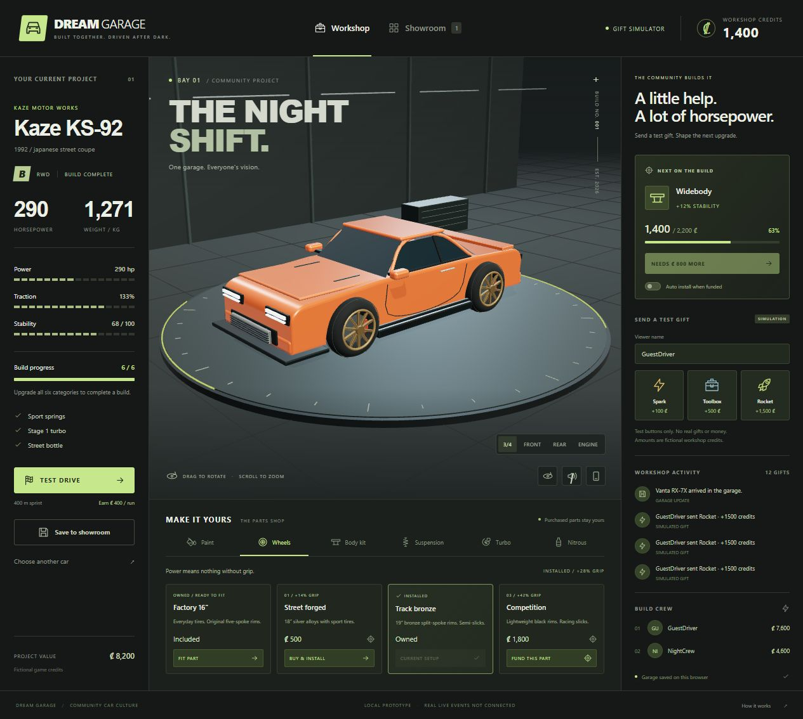

# Dream Garage: After Hours

Launch **DREAM-GARAGE.bat**, or run `npm run garage` and open **http://127.0.0.1:3210**. The independent server listens only on this computer and does not start a TikTok connection. The existing racing game and LIVE configuration remain separate.

## Screenshot

## The game loop

Choose a car, fit parts, dial in a setup, test it, earn credits and reputation, and save a named build to the community showroom. The starter Kaze and 2,600 credits are included. Buy a Vanta for 8,000 or an Atlas for 14,000. Switching projects preserves their setups.

The district has six working destinations:

| Destination | What you can do |
| --- | --- |
| The Workshop | Inspect and tune the car, service it, save builds |
| Parts Depot | Browse 13 categories and jump into their shop pages |
| Color Theory | Visit the brighter paint booth; choose finish and color |
| The Tuning Lab | Adjust boost, final drive, camber, and stance; run a five-second dyno |
| Dockside Strip | Enter the 400 m sprint; unlock the 800 m event at REP 2 |
| The Collection | Buy another project; inspect builds and contributors |

The map is an interactive 3D destination selector with orbit and zoom, not a free-driving open world.

## Parts and setup

**13 categories / 39 purchasable upgrades**, plus stock equipment: paint, wheels, tires, body kits, suspension, turbo, nitrous, exhaust, brakes, transmission, ECU, cooling, and lighting. Purchased parts stay in each car's inventory and can be refitted for free when the setup meets its requirements. Cards show prices, ownership, stat changes, and requirements.

- Stage 2 turbo requires a street ECU remap and alloy radiator or better.
- Stage 3 turbo requires a standalone ECU and bar-plate cooling or better.
- Race nitrous requires a standalone ECU or better.
- Removing supporting equipment required by an installed part is prevented.
- Tires and suspension affect launch grip; wheels reduce mass.
- Exhaust and ECU add power. Transmissions improve delivery efficiency.
- Short final drives improve acceleration but reduce the gearing limit.
- Extra boost adds power and heat; cooling reduces temperature rise. Overheating limits power.
- Camber adds stability but reduces straight-line grip. Suspension and extra drop change stance visibly.
- Brakes improve the displayed estimate for stopping from 100 km/h. Sprint events do not include a measured braking phase.
- Lighting changes headlights and adds underbody strips at higher tiers.

The dyno shows calculated horsepower and torque curves, estimated wheel horsepower, and the gearing limit. This is a simplified gameplay model. The first completed dyno per car awards 60 REP; rechecks are free.

## Progression without gifts

The 400 m sprint pays 400 credits and 60 REP. The 800 m event pays 650 credits and 90 REP. Reputation increases every 300 XP. Five contracts reward work such as fitting supporting equipment, building grip, and completing a dyno. Contract rewards can be claimed only once.

Hard runs reduce condition. High boost and heat add wear; lower condition reduces power. Service costs 12 credits per missing condition point, rounded up. Condition bottoms out at 60%, so the car remains usable.

The car accelerates automatically. Hold Space or the nitrous button to boost if a bottle is installed. Nitrous refills every run. Tire-limited launches can waste an early burst: timing matters.

## Simulated community gifts

Spark adds 100, Toolbox adds 500, and Rocket adds 1,500 fictional credits. Viewer names appear in the activity feed and contribution ranking. The target icon makes a part the community goal. Auto install buys one funded, compatible goal when enabled or when a gift arrives, then chooses the next upgrade. During a test, installation waits until the run ends.

**No real gifts, payments, TikTok Coin conversions, LIVE gift ingestion, or official game-library listing are connected.** Real integration still needs verified delivery, streak handling, deduplication, gift mapping, and reconnect behavior.

The phone icon opens `?overlay=1`, a vertical preview synchronized through browser-local messages. Keep one host tab open in the same browser and origin. It is a prototype composition, not a verified LIVE Studio integration.

## Saves and compatibility

Progress is local to this browser and origin under the existing `dream-garage.v1` key. The data schema is version 2; earlier saves migrate without losing cars, credits, inventory, or showroom snapshots. Earlier wheel/tire packages receive their matching tire compound, and equipped legacy high-stage engines receive their supporting parts.

Use the same address and port. `localhost` and `127.0.0.1`, other ports, other browsers, and incognito sessions have separate saves. Clearing browser data removes progress. Use one workshop tab; there is no server-backed save or multi-host lock.

## Assets and development

Original Blender models, GLBs, thumbnails, and generated art live in `public/garage/assets`. Read `ASSET-NOTES.md` there for the editable source, generator command, and exact image-generation prompt. Blender is needed only to regenerate assets, not to play.

Three.js loads the models, batches the workshop by material, and renders upgrades. Procedural geometry remains a fallback. The three original cars share a modeling system with different rooflines and details.

No new runtime dependencies. Run `npm run test:garage` for economy, physics, migration, compatibility, tuning limits, contracts, service, and event rewards.
